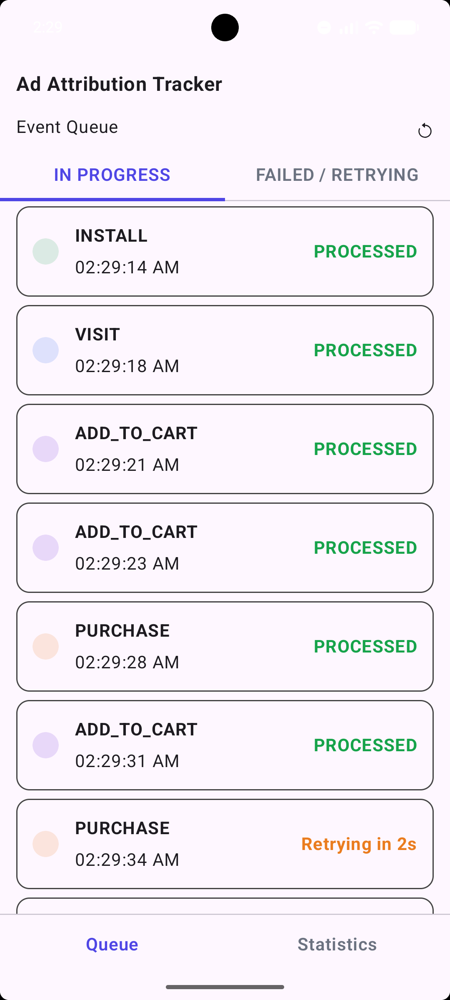
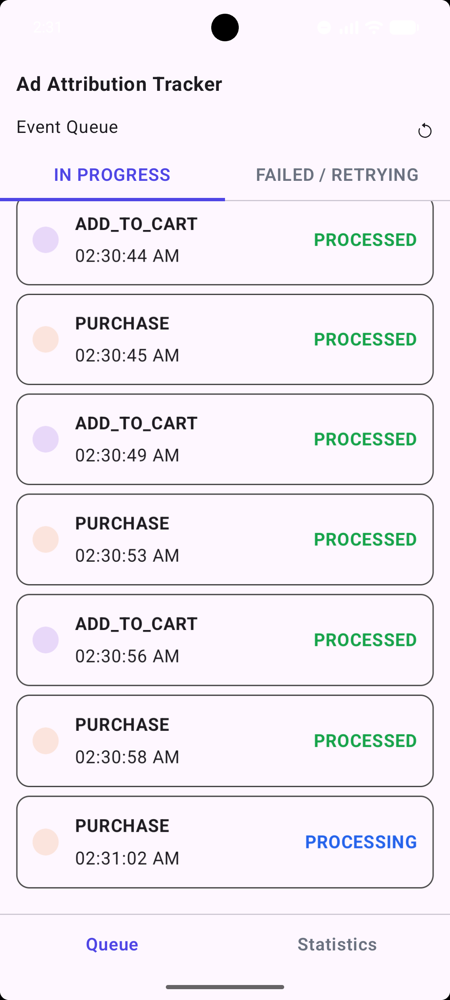
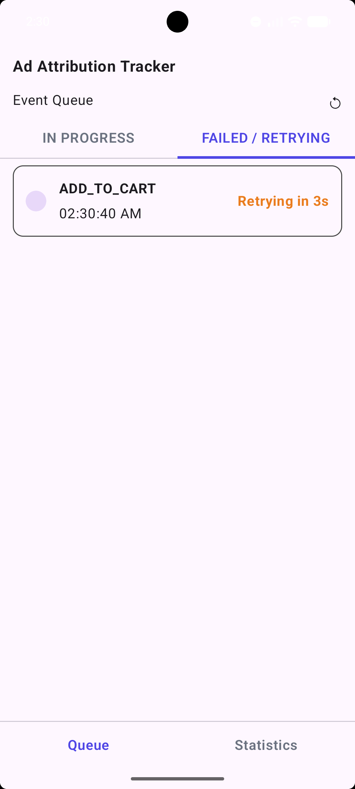
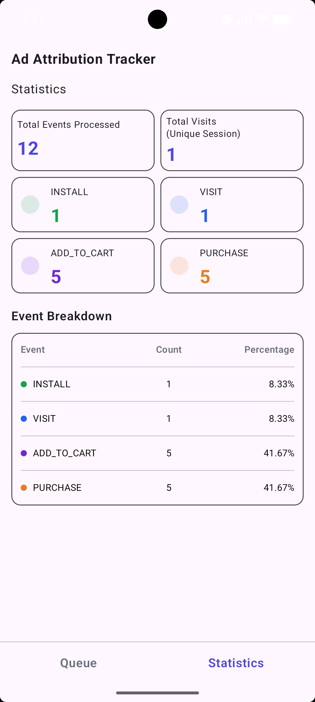

TAO-AAT is an Ad Attribution Tracker built for The Alter Office assignment. Built with Kotlin,
Coroutines, Flow, Jetpack Compose, Room, and Nav3. Built on MVVM with UDF, combined with principles
of Clean Architecture.

`AttributionRepoTest` in `androidTest` covers the integration tests for the core spec requirements
and how the repository handles the ingestion and retry mechanism.

This assignment/project uses a custom `DIContainer` to support manual dependency injection.

### Spec

(Copy-pasted from the assignment)

1. Event Collection
    - Expose a function that allows the application to report events.
    - Add a timestamp and the current sessionId to each event when it enters the queue.

2. Strict Deduplication Rules
    - INSTALL : Process only once.
    - VISIT : Process only once per session.

3. Other Supported Events

    - PURCHASE
    - ADD_TO_CART

4. Local Database for Ingestion Mocking

    - Simulate event ingestion using a Room database.
    - Add a random delay of 1 to 5 seconds between ingestion calls.
    - Introduce a 20% random failure rate to validate the retry mechanism.
    - Retry failed events until they are processed successfully.
    - Ensure that events are not lost if the application is closed.

5. Persistence

    - Store all successfully processed events in a Room database.

6. Application Screens _(refer to the screenshots below)_

##### Screen 1: Event Queue

Display the current processing status of events, including:

- In Progress
- Failed / Retrying

##### Screen 2: Statistics

Display:

- A list of successfully processed events
- Total number of events processed
- Total visits
- Event-wise statistics

### Screenshots

|           IN PROGRESS           |          IN PROGRESS          |
|:-------------------------------:|:-----------------------------:|
|    |  |
|        FAILED / RETRYING        |          Statistics           |
|  |    |
